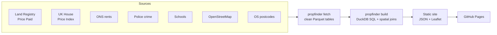

# London Property Finder

[](https://github.com/EgeErenler/london-property-finder/actions/workflows/ci.yml)
[](https://github.com/EgeErenler/london-property-finder/actions/workflows/build.yml)

Find the right London street before the right home.

**Live site: [egeerenler.com/london-property-finder](https://egeerenler.com/london-property-finder/)**

You choose a budget, the types of home you want and what matters to you. The site ranks
about 38,000 London streets and shows, for each one, what homes really sold for, what they
are worth today, the likely rental yield, price growth, crime, stations, supermarkets and
schools. One click opens the homes for sale in that area on Rightmove, Zoopla or OnTheMarket.

Everything is built from official open data and rebuilt automatically every day.

## What you can do

- **Search by budget and type.** A street matches when the middle half of its prices for a
  chosen type overlaps your budget.
- **Pick a profile.** Investor, Family, Professional or Balanced. Each one weighs seven scores
  differently, and you can move every weight yourself.
- **Filter** by borough, walk to a station, crime level, freehold, value picks and busy streets.
- **Open a street** to see its scorecard, prices by type, nearby places and every recent sale,
  with an estimate of each home's value today.
- **Compare boroughs** on price, rent, yield and growth.
- **Share a search.** Every filter is kept in the address, so a link opens the same results.

## How it works



1. **Fetch.** Each source has its own module in `src/propfinder/sources/`. It downloads the
   raw file and writes a clean Parquet table with a fixed schema.
2. **Value every home.** Each home's last sale price is brought to today's level with the
   UK House Price Index for its borough and property type.
3. **Group into streets.** Homes are grouped by street name and postcode district. A street
   needs at least three different homes sold to appear.
4. **Measure the surroundings.** Distances are worked out on the British National Grid
   (metres) with a KD-tree: crimes within 250 m, nearest station and supermarket, schools
   within 1 km and 1.5 km.
5. **Score.** Every measure becomes a percentile from 0 to 100 across all London streets.
6. **Export.** A compact street list (about 6 MB, whole numbers only) loads with the page.
   Details and sales load per postcode district when a street is opened.

A GitHub Actions workflow runs all of this every morning and deploys the site. Large
downloads are cached, and the 1.7 GB crime archive is only downloaded again when it changes.

## The seven scores

| Score | Based on |
|---|---|
| Low crime | Crimes reported within 250 m in the last 12 months |
| Transport | Walking distance to the nearest Tube, rail, Overground, DLR, Elizabeth line or tram station |
| Shops | Distance to the nearest supermarket |
| Schools | State primary schools within 1 km, distance to the nearest, secondary schools within 1.5 km |
| Value | Typical home compared with the same type in the same borough |
| Growth | Yearly price change of homes on the street that sold twice |
| Yield | Borough average rent for that type of home, divided by today's value |

## Data sources

| Data | Publisher | Update | Licence |
|---|---|---|---|
| Price Paid Data | HM Land Registry | Monthly | Open Government Licence |
| UK House Price Index | HM Land Registry / ONS | Monthly | Open Government Licence |
| Price Index of Private Rents | ONS | Monthly | Open Government Licence |
| Street-level crime | data.police.uk | Monthly | Open Government Licence |
| Get Information About Schools | Department for Education | Daily | Open Government Licence |
| Stations and supermarkets | OpenStreetMap | Live | ODbL |
| Code-Point Open | Ordnance Survey | Quarterly | Open Government Licence |

Homes for sale are not copied from any portal. The site links to the portals' own search pages.

## Run it yourself

```bash
pip install -e ".[dev]"

# Work offline with synthetic data in the real schemas
propfinder sample
propfinder build
python -m http.server -d site 8000

# Or download everything (about 3 GB, takes 5 to 10 minutes)
propfinder fetch
propfinder build
```

## Tests

```bash
pytest
```

The tests check the parsers for each source, that sale prices are brought to today's level
correctly, the value gap and yield maths, distances in metres, the scoring, and that the
whole site builds from sample data. CI also runs `ruff`.

## Limits

- The data has no floor area or bedrooms, so a low price can mean a smaller home.
- Yield uses borough average rents, so it is a rough guide, before costs.
- Crime counts are highest in busy town centres, even where homes are safe.
- School quality is not included yet.
- This is information, not financial advice.

## Project layout

```
src/propfinder/
  sources/     one module per data source: fetch + clean
  build.py     DuckDB SQL for homes and streets, spatial measures, scores
  export.py    compact JSON for the site
  geo.py       coordinate conversion and nearest-neighbour helpers
  sample.py    synthetic data for tests and offline work
web/           the app: index.html, app.js, styles.css (no build step)
tests/
```

## Author

Ege Erenler · [egeerenler.com](https://egeerenler.com) · [LinkedIn](https://www.linkedin.com/in/ege-erenler)

Contains HM Land Registry data © Crown copyright and database right 2026. Contains OS data
© Crown copyright and database right 2026. Contains public sector information licensed under
the Open Government Licence v3.0. Map data © OpenStreetMap contributors.
